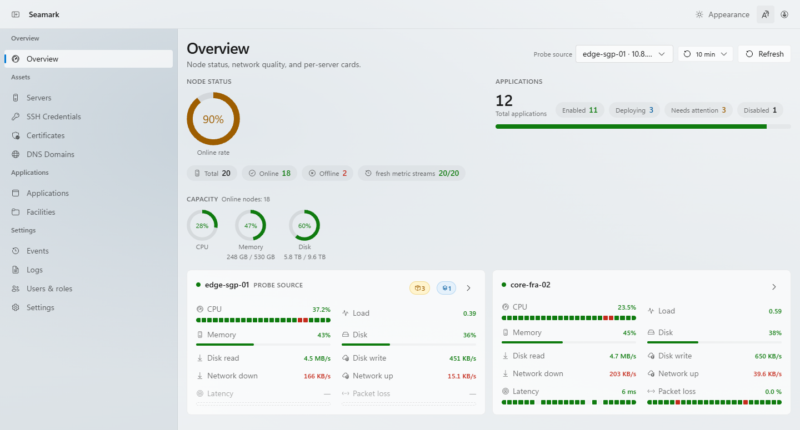

<div align="center">

<h1>Seamark</h1>

<p><strong>A self-hosted operations panel for a handful of Linux servers.</strong></p>

<p>
  
  
  
  
  
</p>

<p>English | <a href="README.zh-CN.md">简体中文</a></p>

</div>



<p align="center"><sub>The Overview page with demo data. The UI ships in English and Simplified Chinese.</sub></p>

Seamark brings SSH access, health metrics, APT maintenance, container application delivery, an Nginx entry gateway, DNS, ACME certificates, and encrypted backups into a single web UI. It is built for people who run their own Debian and Ubuntu machines, not for platform teams operating a cluster.

It runs as one container backed by local SQLite storage, with a small mTLS agent on each managed server. No external database, no Kubernetes, and no Docker socket mounted into Panel.

> **Alpha status.** Seamark is usable, but configuration, database migrations, and UI behavior can still change between releases. Back up the data volume before every upgrade and try significant changes on non-critical servers first.

## Features

- **Fleet management.** Add servers with password or key SSH credentials, confirm host keys on first contact, and route connections through another managed server or a SOCKS5 proxy.
- **Health and maintenance.** 24-hour metrics on the overview, node-to-node latency and packet loss, APT refreshes and upgrades, scheduled security updates, and UFW rules.
- **Container applications.** Describe an application once — image, files, mounts, ports, health checks, and proxy routes — then validate it, save an immutable revision, and roll it out to one or more servers.
- **Edge and certificates.** A managed Nginx gateway with per-domain HTTPS, HTTP/2, HTTP/3, HSTS, custom directives, and rolling updates. Cloudflare DNS, DNS-01 ACME certificates, self-signed CAs, and a key asset list.
- **Facilities.** NFS storage shares, network probes, and configurable metrics collection with retention and warning thresholds.
- **Operations and access.** Event stream and JSONL logs, in-app notifications, backup and restore, automatic updates, multi-user roles, scoped access tokens, and an English/Chinese UI.

## Quick start

You need a Linux host with Docker Engine and the Compose plugin. Panel is separate from the servers it manages.

```yaml
services:
  panel:
    image: ghcr.io/delichik/panel:latest
    container_name: panel
    restart: unless-stopped
    ports:
      - "127.0.0.1:8443:8443"
    volumes:
      - panel-data:/app/data

volumes:
  panel-data:
    name: panel-data
```

```bash
docker compose up -d
```

Open `https://127.0.0.1:8443`. On first start, create the initial administrator (defaults: `admin` / `admin`) and choose a new password. The built-in TLS certificate is self-signed.

The example binds to loopback. Use `8443:8443` or a TLS-terminating reverse proxy for remote access. Keep `/app/data` on the same volume across upgrades, and make sure it is owned by the image's `panel` user if you reuse a volume from another setup.

## Documentation

- [Deployment guide](docs/deployment.md) — Compose and Docker, HTTPS, persistent data, backups, upgrades, troubleshooting.
- [User guide](docs/user-guide.md) — first login, credentials, servers, agents, the first application, domains, certificates, and daily work.
- [Acceptance specifications](docs/agents/acceptance/README.md) — behavior contracts and the change-impact matrix for contributors.
- [i18n guide](docs/agents/i18n-guide.md) — rules for user-visible copy and translations.

## Architecture

```text
Browser
  │ HTTPS 8443
  ▼
Seamark Panel ── SSH ─────────────────► managed servers
  │ Go + Vue                          ├─ panel-agent :9786 (gRPC, mTLS)
  │                                   │    ├─ Docker Engine API
  │                                   │    ├─ APT / systemd / UFW
  │                                   │    └─ Nginx gateway, NFS exports
  └─ SQLite ×4 + dataRoot
```

Panel keeps control-plane state in four SQLite databases under one data directory, serves the built frontend, and talks to servers over SSH or the mTLS agent. The agent reports metrics, applies container desired state, and runs privileged node operations under its own mTLS identity; Panel never mounts the host's Docker socket.

## Supported systems

`Debian 12` · `Debian 13` · `Ubuntu 20.04` · `Ubuntu 22.04` · `Ubuntu 24.04` · `Ubuntu 24.10` · `Ubuntu 25.04` · `Ubuntu 25.10` · `Ubuntu 26.04`

Targets must be `amd64` or `arm64`, reachable over SSH, with root or passwordless sudo for maintenance. Other distributions can be probed, but APT/systemd/UFW writes are refused. See the [deployment guide](docs/deployment.md) for agent prerequisites.

## Development

Go 1.25+, Node.js 22+, npm, and [Task](https://taskfile.dev/). Docker is only needed to build the image; `protoc` only to regenerate the agent protocol.

```bash
npm --prefix web ci
cp config.example.json config.json
export PANEL_CONFIG=./config.json

# terminal 1
task run:backend

# terminal 2
task run:web
```

Open `http://127.0.0.1:5173` and complete setup with `admin` / `admin`. The development backend listens on `127.0.0.1:8080`; Vite proxies `/api` to it.

<details>
<summary><strong>Configuration, tasks, and project layout</strong></summary>

### Configuration

Configuration loads from built-in defaults, then the JSON file named by `PANEL_CONFIG`, then environment variables. Relative paths resolve from the config file's directory.

| Key | Purpose | Default |
| --- | --- | --- |
| `listenAddress` | Backend listen address | `127.0.0.1:8443` |
| `dataRoot` | Root directory for Seamark data | `data` |
| `appDatabase` | Application SQLite database | `data/db/app.db` |
| `logDatabase` | Log and event-index SQLite database | `data/db/log.db` |
| `coordinationDatabase` | Coordination SQLite database | `data/db/coordination.db` |
| `metricsDatabase` | Metrics time-series SQLite database | `data/db/metrics.db` |
| `certificates.acmeDirectoryUrl` | ACME directory URL | Let's Encrypt production |

Environment overrides: `PANEL_CONFIG`, `PANEL_LISTEN_ADDRESS`, `PANEL_ADMIN_USERNAME`, `PANEL_ADMIN_DISPLAY_NAME`, `PANEL_ADMIN_PASSWORD`, `PANEL_ADMIN_PASSWORD_HASH`, `PANEL_DATA_ROOT`, `PANEL_APP_DATABASE`, `PANEL_LOG_DATABASE` (legacy alias `PANEL_TASK_DATABASE`), `PANEL_COORDINATION_DATABASE`, `PANEL_METRICS_DATABASE`, `PANEL_CERT_ACME_DIRECTORY_URL`, and `PANEL_WEB_PROXY_TARGET` for the Vite proxy.

Runtime settings such as token lifetime, command timeout, appearance, agent download, automatic updates, image registry, and backup options are stored in the application database and managed from **Settings**.

### Tasks

```bash
task run:backend          # Panel backend
task run:web              # Vite dev server
task run:web:test         # frontend against the mock API
task test:backend         # Go tests
task test:web             # frontend unit tests
task test:agent           # agent tests
task test:appdeploy       # application deployment integration tests
task build:backend        # compile Go packages
task build:web            # type-check and build the frontend
task build                # both sides
```

`task generate:agent-contract-hash` refreshes the agent gRPC contract hash. `task generate:agent-proto` regenerates protobuf bindings.

### Project layout

```text
cmd/panel/                      Panel server and web host
cmd/panel-init/                 container PID 1 supervisor
cmd/panel-agent/                agent installed on managed servers
internal/agent/                 agent runtime: gRPC, Docker, NFS, probes
internal/orchestrator/          application desired/observed reconciliation
internal/modules/               domain modules
internal/platform/              config, SQLite/ORM, logging, SSH, Linux adapters
web/                            Vue 3 + TypeScript frontend
docs/                           deployment, user guide, acceptance specs
```

</details>

### Releases

`version.json` holds the major and minor version. Pushes to `main` produce semver tags, `latest`, and commit-tagged images plus a GitHub Release; pushes to `dev` publish only the `dev` tag. Images are multi-architecture and include agent bundles for both supported architectures.

## Contributing

Read [AGENTS.md](AGENTS.md) and the [acceptance specification index](docs/agents/acceptance/README.md) before changing behavior. Frontend work follows the [design specification index](docs/agents/specifications/frontend/INDEX.md); user-visible copy follows the [i18n guide](docs/agents/i18n-guide.md). Run only the checks relevant to your change.

## License

No license file is included yet. Treat the repository as all rights reserved and ask the project owner before reusing or redistributing it.
