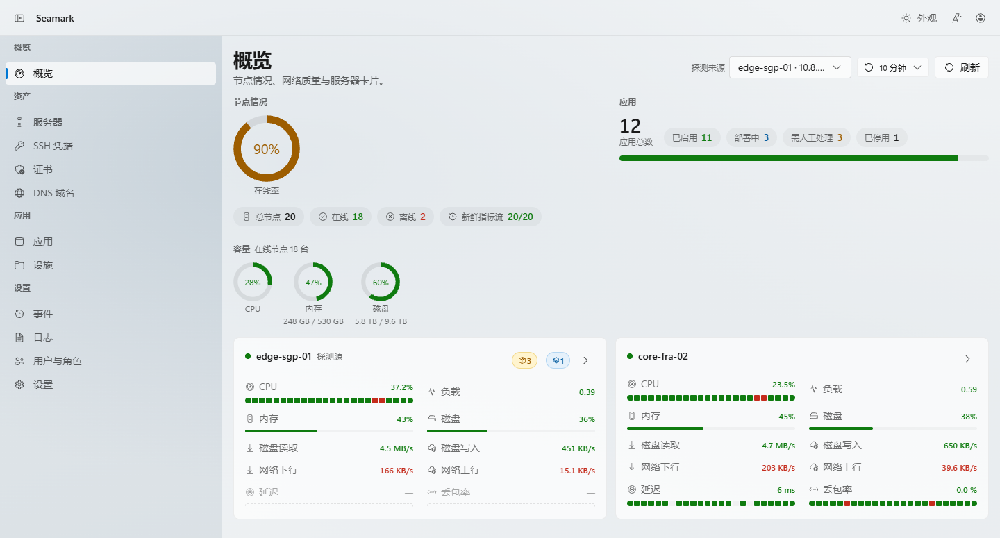

<div align="center">

<h1>Seamark</h1>

<p><strong>面向少量自有 Linux 服务器的自托管运维面板。</strong></p>

<p>
  
  
  
  
  
</p>

<p><a href="README.md">English</a> | 简体中文</p>

</div>



<p align="center"><sub>概览页截图，使用演示数据；界面支持英文和简体中文。</sub></p>

Seamark 把 SSH 接入、健康监控、APT 维护、容器应用发布、Nginx 入口网关、DNS、ACME 证书和加密备份集中到一个 Web 界面，面向运行自有 Debian / Ubuntu 机器的个人或小团队。

它以一个容器运行，使用本地 SQLite 存储，并向每台被管服务器部署一个小型 mTLS Agent。不需要外部数据库和 Kubernetes，Panel 也无需挂载宿主机的 Docker socket。

> **Alpha 阶段。** Seamark 已经可用，但版本之间的配置、数据库迁移和界面行为仍可能变化。每次升级前备份数据卷，重要改动先在不关键的服务器上验证。

## 功能

- **服务器管理。** 使用密码或私钥 SSH 凭据登记服务器，首次连接确认主机密钥，并可通过另一台被管服务器或 SOCKS5 代理建立连接。
- **健康与维护。** 概览展示最近 24 小时指标，支持节点间延迟与丢包、APT 刷新与升级、定时安全更新以及 UFW 规则管理。
- **容器应用。** 一次性描述镜像、文件、挂载、端口、健康检查和代理路由，校验后保存为不可变修订，再发布到一台或多台服务器。
- **入口与证书。** 受管的 Nginx 网关支持逐域名 HTTPS、HTTP/2、HTTP/3、HSTS、自定义指令和滚动更新；同时提供 Cloudflare DNS、DNS-01 ACME 证书、自签 CA 和密钥资产列表。
- **设施。** NFS 存储共享、网络探测，以及可配置采集间隔、保留时长和告警阈值的指标设施。
- **运维与权限。** 事件流与 JSONL 日志、应用内通知、备份还原、自动更新、多用户角色、限定范围的访问凭证，以及中英文界面。

## 快速开始

需要一台安装 Docker Engine 和 Compose 插件的 Linux 主机。Panel 主机与被管服务器是分开的。

```yaml
services:
  panel:
    image: ghcr.io/delichik/panel:latest
    container_name: panel
    restart: unless-stopped
    ports:
      - "127.0.0.1:8443:8443"
    volumes:
      - panel-data:/app/data

volumes:
  panel-data:
    name: panel-data
```

```bash
docker compose up -d
```

打开 `https://127.0.0.1:8443`。首次启动会创建第一个管理员（默认 `admin` / `admin`），首次登录时必须设置新密码。内置 TLS 证书是自签证书。

示例只绑定回环地址。需要远程访问时，改为 `8443:8443`，或在前面放置终止 TLS 的反向代理。升级时继续使用同一个 `/app/data` 数据卷；如果复用了其他环境写入的数据卷，请先确认它归属于镜像内的 `panel` 用户。

## 文档

- [部署说明](docs/deployment.zh-CN.md) — Compose 与 Docker、HTTPS、持久化、备份、升级和常见问题。
- [使用说明](docs/user-guide.zh-CN.md) — 首次登录、凭据、服务器、Agent、第一个应用、域名、证书和日常操作。
- [验收规范](docs/agents/acceptance/README.md) — 行为合同与变更影响矩阵，供贡献者查阅。
- [i18n 指南](docs/agents/i18n-guide.md) — 用户可见文案与翻译规则。

## 架构

```text
浏览器
  │ HTTPS 8443
  ▼
Seamark Panel ── SSH ─────────────────► 被管服务器
  │ Go + Vue                          ├─ panel-agent :9786（gRPC、mTLS）
  │                                   │    ├─ Docker Engine API
  │                                   │    ├─ APT / systemd / UFW
  │                                   │    └─ Nginx 网关、NFS 导出
  └─ SQLite ×4 + dataRoot
```

Panel 在同一个数据目录下用四个 SQLite 数据库保存控制面状态，托管构建好的前端，并通过 SSH 或 mTLS Agent 与被管服务器通信。Agent 负责上报指标、收敛容器期望状态，并以自己的 mTLS 身份执行节点上的特权操作；Panel 不挂载宿主机的 Docker socket。

## 支持的系统

`Debian 12` · `Debian 13` · `Ubuntu 20.04` · `Ubuntu 22.04` · `Ubuntu 24.04` · `Ubuntu 24.10` · `Ubuntu 25.04` · `Ubuntu 25.10` · `Ubuntu 26.04`

目标服务器必须为 `amd64` 或 `arm64`，可通过 SSH 访问，并具备 root 或免密 sudo 以执行维护操作。其他发行版可以被探测，但 APT/systemd/UFW 写操作会被拒绝。Agent 的前置条件见[部署说明](docs/deployment.zh-CN.md)。

## 开发

需要 Go 1.25+、Node.js 22+、npm 和 [Task](https://taskfile.dev/)。Docker 仅用于构建镜像，`protoc` 仅在重新生成 Agent 协议时需要。

```bash
npm --prefix web ci
cp config.example.json config.json
export PANEL_CONFIG=./config.json

# 终端 1
task run:backend

# 终端 2
task run:web
```

打开 `http://127.0.0.1:5173`，使用 `admin` / `admin` 完成初始化。开发后端监听 `127.0.0.1:8080`，Vite 会把 `/api` 代理到该地址。

<details>
<summary><strong>配置、任务与目录结构</strong></summary>

### 配置

配置按内置默认值、`PANEL_CONFIG` 指向的 JSON 文件、环境变量的顺序加载。相对路径以配置文件所在目录为基准。

| 配置项 | 用途 | 默认值 |
| --- | --- | --- |
| `listenAddress` | 后端监听地址 | `127.0.0.1:8443` |
| `dataRoot` | Seamark 数据根目录 | `data` |
| `appDatabase` | 应用 SQLite 数据库 | `data/db/app.db` |
| `logDatabase` | 日志与事件索引 SQLite 数据库 | `data/db/log.db` |
| `coordinationDatabase` | 协调 SQLite 数据库 | `data/db/coordination.db` |
| `metricsDatabase` | 指标时间序列 SQLite 数据库 | `data/db/metrics.db` |
| `certificates.acmeDirectoryUrl` | ACME 目录地址 | Let's Encrypt 正式环境 |

环境变量：`PANEL_CONFIG`、`PANEL_LISTEN_ADDRESS`、`PANEL_ADMIN_USERNAME`、`PANEL_ADMIN_DISPLAY_NAME`、`PANEL_ADMIN_PASSWORD`、`PANEL_ADMIN_PASSWORD_HASH`、`PANEL_DATA_ROOT`、`PANEL_APP_DATABASE`、`PANEL_LOG_DATABASE`（兼容旧名 `PANEL_TASK_DATABASE`）、`PANEL_COORDINATION_DATABASE`、`PANEL_METRICS_DATABASE`、`PANEL_CERT_ACME_DIRECTORY_URL`，以及用于 Vite 代理的 `PANEL_WEB_PROXY_TARGET`。

Token 有效期、命令超时、外观、Agent 下载、自动更新、镜像仓库和备份选项等运行时设置保存在应用数据库中，通过界面的 **设置** 管理。

### 常用任务

```bash
task run:backend          # 运行 Panel 后端
task run:web              # 运行 Vite 开发服务器
task run:web:test         # 使用 Mock API 运行前端
task test:backend         # Go 测试
task test:web             # 前端单元测试
task test:agent           # Agent 测试
task test:appdeploy       # 应用部署集成测试
task build:backend        # 编译 Go 包
task build:web            # 前端类型检查与构建
task build                # 同时构建前后端
```

`task generate:agent-contract-hash` 刷新 Agent gRPC 合同哈希；`task generate:agent-proto` 重新生成 protobuf 绑定。

### 目录结构

```text
cmd/panel/                      Panel 服务与 Web 托管入口
cmd/panel-init/                 容器 PID 1 监督进程
cmd/panel-agent/                部署到被管服务器的 Agent
internal/agent/                 Agent runtime：gRPC、Docker、NFS、探测
internal/orchestrator/          应用期望/观测状态的协调
internal/modules/               领域模块
internal/platform/              配置、SQLite/ORM、日志、SSH、Linux 适配
web/                            Vue 3 + TypeScript 前端
docs/                           部署说明、使用说明和验收规范
```

</details>

### 发布

`version.json` 保存主版本号和次版本号。推送到 `main` 会生成正式 semver 标签、`latest` 和 commit 标签镜像，并创建 GitHub Release；推送到 `dev` 只发布 `dev` 标签。镜像为多架构，并同时包含两种受支持架构的 Agent bundle。

## 参与开发

修改行为前，先阅读 [AGENTS.md](AGENTS.md) 和[验收规范索引](docs/agents/acceptance/README.md)。前端改动遵循[前端设计规范索引](docs/agents/specifications/frontend/INDEX.md)，用户可见文案遵循 [i18n 指南](docs/agents/i18n-guide.md)。只运行与改动范围相关的检查。

## 许可证

当前仓库还没有包含许可证文件。在获得项目所有者明确许可前，请将仓库视为保留所有权利，不要复用或再分发。
